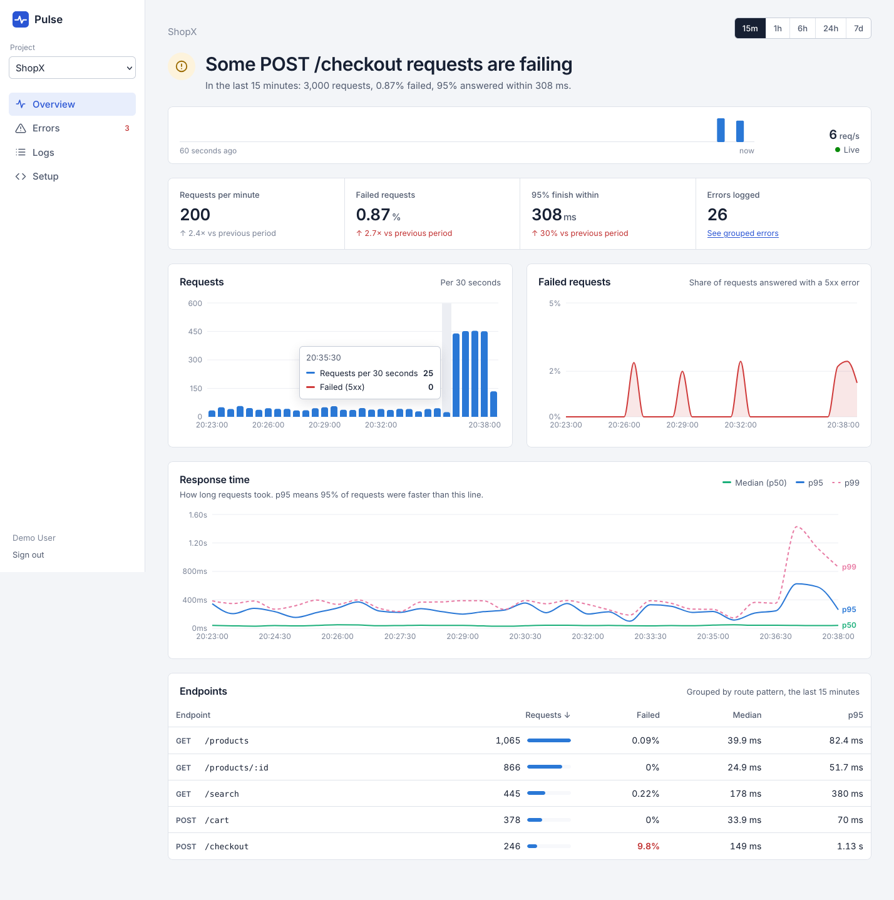
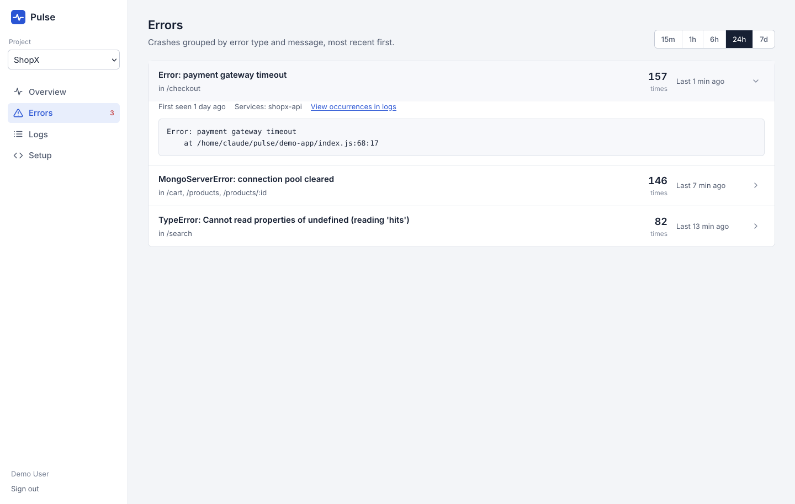
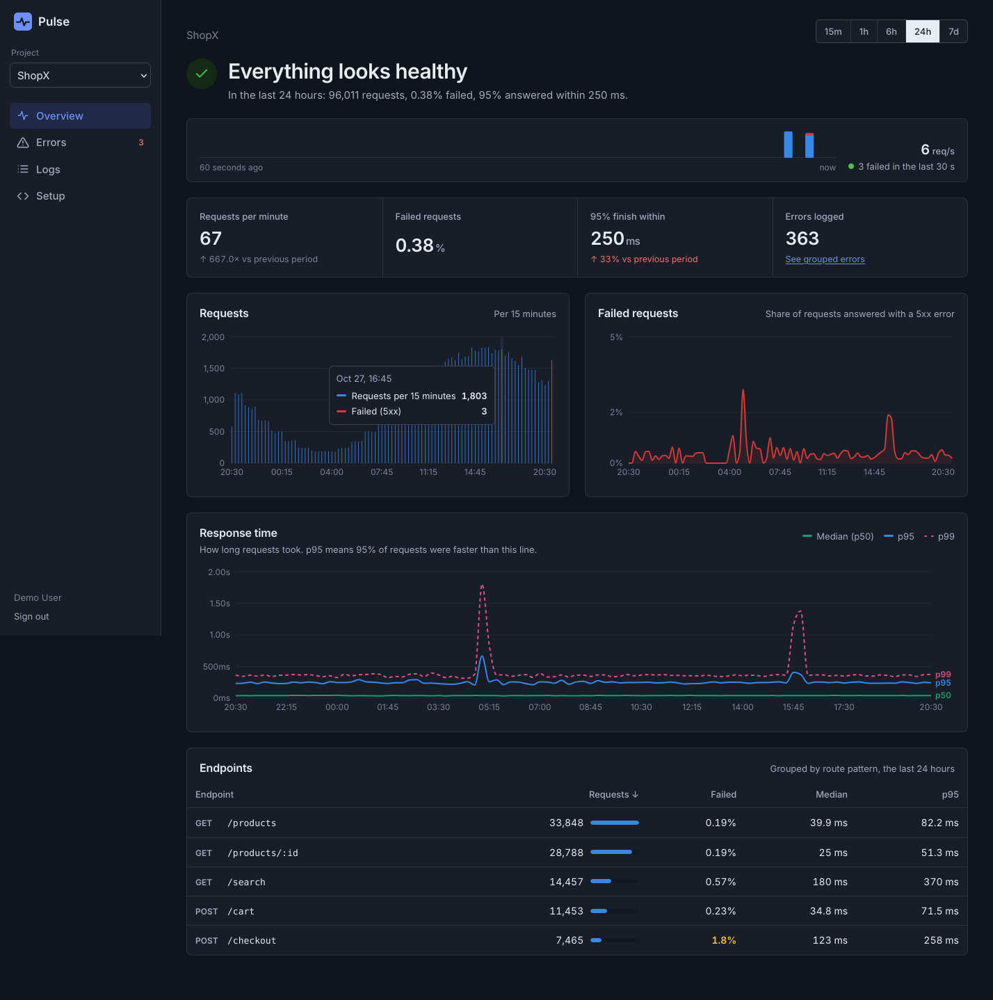

# Pulse

A self-hosted observability platform. A small SDK captures requests, errors and logs from any Express app; a queue-backed pipeline stores them in MongoDB; and a React dashboard shows the app's health live, starting with a plain-language verdict of what's wrong.



```
Your app + pulse-sdk ─HTTP─▶ Ingestion API ─▶ Redis Stream ─▶ Workers ─▶ MongoDB (time-series)
                             auth, validation,  (buffer)       bulk writes,       │
                             rate limiting                     retries, DLQ       │
                                                                  │               ▼
                                                    Redis pub/sub └──▶ API ──WebSocket──▶ React dashboard
```

## What it does

- **Health verdict.** The overview opens with one sentence, such as "POST /checkout is failing 35% of the time", worked out from error rates and latency compared with the previous period.
- **Live traffic.** A per-second strip of incoming requests, pushed over WebSockets the moment workers store them.
- **Charts.** Requests, failure rate and response time (p50, p95, p99) for 15 minutes up to 7 days, with comparison to the previous period.
- **Endpoints.** Every route grouped by pattern (`/orders/:id`, not `/orders/8812`), with traffic, failure rate and latency percentiles.
- **Errors.** Crashes grouped by type and message with counts, first/last seen, affected routes and the latest stack trace.
- **Logs.** Search and filter every event, page back through history, and watch new events stream in.
- **Accounts and projects.** Sign up, create projects, get an API key (stored only as a hash), rotate or delete it.

| | |
|---|---|
|  |  |

## Quick start

Requires Docker.

```bash
docker compose up --build
```

Open **http://localhost:8080** and sign in with `demo@pulse.dev` / `demo-password`. The demo project comes with 24 hours of history, and the ShopX demo app keeps sending live traffic, with a simulated one-minute checkout outage every 5 minutes.

## Project layout

| Folder | What's in it |
|---|---|
| `sdk/` | `pulse-sdk`: Express middleware, batching, retries |
| `server/` | Ingestion API, dashboard API, WebSocket hub, Redis Streams workers |
| `dashboard/` | React + Vite dashboard (Recharts), served by nginx in Docker |
| `demo-app/` | ShopX, a fake shop that generates realistic traffic and incidents |

## Using the SDK

```js
const pulse = require('pulse-sdk').init({
  apiKey: process.env.PULSE_API_KEY,
  endpoint: 'http://localhost:8080',
  service: 'shop-api',
});

app.use(pulse.middleware());     // before your routes
// ...routes...
app.use(pulse.errorHandler());   // after your routes

pulse.info('order placed', { amount: 1999 });
```

Install it from this repo with `npm install path/to/pulse/sdk`, or publish it to npm under your own scope.

## Design decisions

**The SDK can never hurt the host app.** Events are buffered and sent in batches off the request path. The buffer is capped (oldest events dropped first), failures are swallowed, and the flush timer never keeps a process alive. Failed sends retry with exponential backoff and jitter, honour `Retry-After` on 429s, and don't retry errors that can't succeed.

**Routes are grouped by pattern,** using Express's matched route, so one endpoint is one row on the dashboard.

**The ingestion API does as little as possible.** It authenticates, validates and enqueues, then returns `202`. Database writes happen in workers, so a slow database doesn't slow down ingestion. Bad events are rejected individually, so one malformed event doesn't discard a batch. Rate limits count events per project in Redis, so they hold across API instances.

**At-least-once delivery.** Workers read through a Redis consumer group and acknowledge entries only after MongoDB confirms the write. A crashed worker's entries are reclaimed by another (`XAUTOCLAIM`); entries that fail 5 times go to a dead-letter stream so one poison message can't block the pipeline.

**Time-series storage.** Events live in a MongoDB time-series collection bucketed by project, service and type, with automatic expiry (14 days by default). Percentiles are computed in the database with `$percentile`, and chart gaps are filled so lines don't skip missing minutes.

**Live updates scale out.** Workers publish "new data" messages on Redis pub/sub; every API instance subscribes and forwards them to the dashboards watching that project. Sockets authenticate with the same JWT as the REST API and can only watch their own projects.

**Security basics.** Passwords hashed with bcrypt, login attempts rate-limited, constant-time failure path so emails can't be enumerated, API keys stored as SHA-256 hashes, other users' projects answer 404.

**Charts are readable for everyone.** Series colors were checked for color-vision deficiency, every multi-line chart has a legend plus direct labels, and status is always shown with an icon or words, never color alone. Light and dark mode follow the system setting.

## Tests

```bash
cd sdk && npm test
cd server && npm test                                          # needs redis-server installed
TEST_MONGO_URL=mongodb://localhost:27017/pulse_test npm test  # adds MongoDB integration tests
cd dashboard && npm test
```

CI runs all of it, including the MongoDB tests, on every push. Coverage includes SDK batching, retries and error capture; API auth, validation, rate limiting and Redis outages; worker crash recovery and dead-lettering; accounts, project isolation and key rotation; every dashboard query (checked against known data); cursor pagination; WebSocket auth and delivery; an end-to-end run from SDK to database; and the dashboard's health verdict logic.

## Running without Docker

```bash
# MongoDB 7+ and Redis 7+ running locally
cd server && npm install && npm run seed && npm start      # API on :4000
cd server && npm run worker                                # in another terminal
cd dashboard && npm install && npm run dev                 # dashboard on :5173
cd demo-app && npm install && PULSE_API_KEY=pk_local_demo_key_change_me npm start
```

## Configuration

| Variable | Default | |
|---|---|---|
| `MONGO_URL` | `mongodb://localhost:27017/pulse` | |
| `REDIS_URL` | `redis://localhost:6379` | |
| `JWT_SECRET` | dev-only value | **required in production** |
| `RATE_LIMIT_PER_SECOND` | `2000` | events/sec per project |
| `RETENTION_DAYS` | `14` | |
| `WORKER_BATCH_COUNT` | `100` | stream entries per read |
| `WORKER_MAX_DELIVERIES` | `5` | attempts before dead-lettering |

## Roadmap

- Alert rules (e.g. "failure rate above 5% for 2 minutes") with Slack and email notifications
- Load testing with k6 to measure ingestion throughput
- Deployment to AWS
